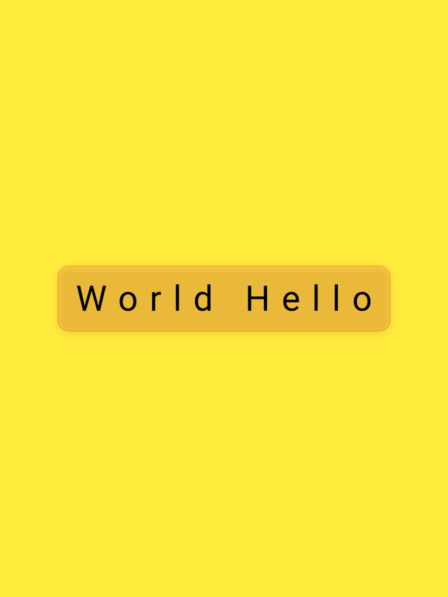

# hello_flutter_1

Prima noastră aplicație Flutter: textul "World Hello", scris cu litere mari într-o casetă roșie semitransparentă, cu colțuri rotunjite și umbră, în mijlocul unui ecran galben.

Aplicația e mică intenționat. Nu are butoane, pagini sau date, doar câteva widget-uri puse unele în altele. Tocmai de aceea e un punct de plecare bun: pe un exemplu atât de mic se văd clar ideile pe care se sprijină orice aplicație Flutter, oricât de mare ar fi.

Acest README este o a doua cale de a învăța Flutter, pe lângă ce facem la curs: înveți Flutter construind aplicații. Citește-l cu codul deschis alături, în `lib/main.dart`.



## Cuprins

- [Ce este Flutter](#ce-este-flutter)
- [Ideea de bază: totul este un widget](#ideea-de-bază-totul-este-un-widget)
- [Codul, pas cu pas](#codul-pas-cu-pas)
- [Fișierele proiectului](#fișierele-proiectului)
- [Cum construiește Flutter aplicația](#cum-construiește-flutter-aplicația)
- [Cum rulezi aplicația](#cum-rulezi-aplicația)
- [Hot reload și hot restart](#hot-reload-și-hot-restart)
- [Comenzi utile](#comenzi-utile)
- [Încearcă și tu](#încearcă-și-tu)
- [Mai departe](#mai-departe)
- [Licență](#licență)

## Ce este Flutter

Flutter este un framework creat de Google pentru aplicații care rulează pe mai multe platforme din același cod: Android, iOS, web, Windows, macOS și Linux. La curs folosim două dintre ele: web (în Chrome sau Edge) și Android (pe telefoanele voastre).

Aplicațiile Flutter se scriu în **Dart**, un limbaj creat tot de Google. Dacă ați lucrat în Java și JavaScript, Dart vă va părea cunoscut:

- Ca în Java, are clase, tipuri de date (`int`, `double`, `String`, `bool`) și o funcție `main` de la care pornește programul.
- Ca în JavaScript, are o sintaxă flexibilă, funcții scrise ușor și liste scrise cu paranteze drepte: `[1, 2, 3]`.

Spre deosebire de alte framework-uri, Flutter nu folosește butoanele și textele "native" ale telefonului sau ale browserului. Desenează singur fiecare pixel de pe ecran, cu propriul motor grafic. De aceea, o aplicație Flutter arată la fel pe Android, pe web și pe orice altă platformă.

## Ideea de bază: totul este un widget

În Flutter, interfața se construiește din **widget-uri**. Un widget este o bucată de interfață: un text, o culoare, o aliniere, o casetă, un spațiu gol. Aproape tot ce vezi pe ecran, și chiar lucruri pe care nu le vezi direct, cum ar fi alinierea, este un widget.

Widget-urile se pun unele în altele, ca piesele de LEGO. Un widget care conține alt widget îl primește prin parametrul `child` (copil). Widget-urile care pot conține mai multe primesc o listă, prin parametrul `children`.

Rezultatul este un **arbore de widget-uri** (widget tree). Pentru aplicația noastră, arborele arată așa:

```
ColoredBox        fundalul galben, pe tot ecranul
  Center          așază child-ul în mijloc
    Container     caseta roșie, cu colțuri rotunjite și umbră
      Text        textul "World Hello"
```

Fiecare widget își primește spațiul de la părinte și îl împarte copilului: `ColoredBox` primește tot ecranul, `Center` pune caseta în mijlocul lui, iar `Container` își așază textul în interior, la 20 de pixeli de margine.

Dacă ați lucrat cu HTML, ideea vă e cunoscută: și acolo elementele stau unele în altele, ca un `<p>` într-un `<div>`. Diferența este că în Flutter totul se scrie în cod Dart, nu există fișiere HTML sau CSS separate. Stilul (culori, margini, umbre) se dă tot prin widget-uri și parametrii lor.

### Declarativ, nu imperativ

În JavaScript, când voiați să schimbați ceva pe pagină, căutați un element și îl modificați: "găsește paragraful și schimbă-i culoarea". Acesta este stilul **imperativ**: îi spui calculatorului pas cu pas ce să facă.

Flutter folosește stilul **declarativ**: descrii cum trebuie să arate ecranul, iar Flutter se ocupă de desenare. Codul din `main.dart` nu spune "desenează un dreptunghi, apoi scrie un text peste el", ci "ecranul este un fundal galben, cu o casetă în mijloc, iar în casetă este un text".

## Codul, pas cu pas

Tot codul aplicației se află în `lib/main.dart`. Comentariile din fișier explică fiecare widget și fiecare parametru pe scurt; aici găsești ideile din spatele lor.

### Importul

```dart
import 'package:material_ui/material_ui.dart';
```

Importul aduce în fișier widget-urile și clasele de care avem nevoie, cum ar fi `Text`, `Container` sau `Colors`. Este asemănător cu `import` din Java sau din JavaScript.

`material_ui` este pachetul cu widget-urile **Material Design**, stilul vizual creat de Google. Începând cu Flutter 3.50, acesta este un pachet separat, descărcat de pe [pub.dev](https://pub.dev), depozitul public de pachete pentru Dart și Flutter. Îl găsești trecut în `pubspec.yaml`, la `dependencies`.

### Funcția main și runApp

```dart
void main() {
  runApp(
    ColoredBox(...),
  );
}
```

Ca în Java, programul pornește din funcția `main`. Aici, `main` face un singur lucru: apelează `runApp` și îi dă widget-ul rădăcină, primul widget din arbore. `runApp` îl întinde pe tot ecranul și îl desenează.

### Parametrii cu nume

```dart
ColoredBox(
  color: Colors.yellow,
  child: Center(...),
)
```

`ColoredBox(...)` creează un obiect, ca un constructor din Java. Spre deosebire de Java, în Dart nu e nevoie de cuvântul `new`.

Valorile se dau prin **parametri cu nume**: `color:`, `child:`. Seamănă cu proprietățile unui obiect JavaScript, `{ color: ..., child: ... }`. Ordinea lor nu contează, iar numele arată clar ce reprezintă fiecare valoare. Așa se poate citi codul fără să cauți în documentație ce înseamnă al treilea parametru.

Virgula de după ultimul parametru nu este o greșeală. Ea îi spune lui `dart format` să pună fiecare parametru pe rândul lui, ceea ce face arborele de widget-uri mai ușor de citit.

### Widget-urile aplicației

- **`ColoredBox`** umple tot spațiul primit cu o culoare. Aici, `Colors.yellow`, galben. `Colors` conține culorile predefinite din Material Design.
- **`Center`** așază child-ul în mijlocul spațiului disponibil. Fără el, caseta ar fi întinsă pe tot ecranul.
- **`Container`** este widget-ul "la toate": o casetă care poate avea fundal, colțuri rotunjite, bordură, umbră și spațiu interior. Este cel mai apropiat de un `<div>` stilizat cu CSS.
- **`BoxDecoration`** descrie cum arată caseta: culoarea (`color`), colțurile (`borderRadius`), bordura (`border`) și umbra (`boxShadow`). Umbra este o listă, pentru că o casetă poate avea mai multe umbre suprapuse.
- **`Text`** afișează un șir de caractere. Este unul dintre widget-urile cele mai simple și cele mai folosite.
- **`TextStyle`** stabilește cum arată textul: culoarea, mărimea literelor (`fontSize`), spațiul dintre ele (`letterSpacing`) și multe altele.

### Culori și transparență

```dart
Colors.redAccent.withValues(alpha: 0.2)
```

`withValues(alpha: 0.2)` creează o copie a culorii, cu opacitate de 20%. `alpha` merge de la `0` (complet transparent) la `1` (complet opac). Prin caseta roșie semitransparentă se vede fundalul galben, de aceea caseta pare portocalie.

### Pixeli logici

Mărimile din Flutter (`fontSize: 60`, `padding` de 20, raza de 20 a colțurilor) sunt în **pixeli logici**, nu în pixeli fizici. Un ecran de telefon modern are de 2 sau 3 ori mai mulți pixeli fizici decât unul mai vechi, de aceea Flutter calculează singur conversia, astfel încât un text de 60 să aibă aproximativ aceeași mărime vizuală pe orice ecran.

### De ce textDirection

```dart
textDirection: TextDirection.ltr,
```

Există limbi care se scriu de la dreapta la stânga, cum ar fi araba sau ebraica. Ca să știe cum să așeze textul, widget-ul `Text` are nevoie de direcția scrisului.

De obicei, aplicațiile Flutter pornesc dintr-un widget numit `MaterialApp`, care stabilește automat direcția, tema, fonturile și multe altele. Aplicația noastră e atât de simplă încât nu folosește `MaterialApp`, așa că trebuie să-i spunem noi lui `Text` direcția: `ltr`, adică left to right, de la stânga la dreapta. În aplicațiile următoare vom folosi `MaterialApp`, iar acest parametru nu va mai fi necesar.

### const

```dart
child: const Text(...)
```

`const` îi spune lui Dart că valoarea nu se va schimba niciodată și poate fi creată o singură dată, când se compilează aplicația. Asta face aplicația puțin mai rapidă. Analizorul ne arată singur unde se poate pune `const`.

Nu orice widget poate fi `const`: caseta noastră nu poate, pentru că `withValues(...)` și `BorderRadius.circular(...)` calculează valori abia când rulează aplicația.

## Fișierele proiectului

```
hello_flutter_1/
  lib/
    main.dart               codul aplicației
  test/
    widget_test.dart        testul aplicației
  android/                  proiectul Android, generat de Flutter
  web/                      pagina web în care rulează aplicația
  readme-assets/            imaginile din acest README
  pubspec.yaml              numele, versiunea și pachetele proiectului
  pubspec.lock              versiunile exacte ale pachetelor folosite
  analysis_options.yaml     regulile de verificare și formatare a codului
  README.md                 acest fișier
```

- **`lib/`** este locul în care scrii codul. Aproape tot ce vom face la curs se întâmplă aici.
- **`test/`** conține testele: cod care pornește aplicația și verifică automat că face ce trebuie. Testul nostru verifică că pe ecran apare textul "World Hello".
- **`android/`** și **`web/`** sunt generate de `flutter create`, comanda care creează un proiect nou. Conțin ce are nevoie fiecare platformă ca să pornească aplicația: pentru Android, fișierele de build Gradle și setările aplicației; pentru web, pagina `index.html` și iconițele. De obicei nu le modificăm.
- **`pubspec.yaml`** descrie proiectul și pachetele de care are nevoie, ca `package.json` din JavaScript sau `pom.xml` din Java. Comentariile din fișier explică fiecare setare.
- **`pubspec.lock`** este generat automat și reține versiunile exacte ale pachetelor descărcate, ca toți cei care lucrează la proiect să folosească aceleași versiuni. Nu se modifică de mână.
- **`analysis_options.yaml`** configurează analizorul (care caută probleme în cod) și formatarea automată a codului.

Pe lângă acestea, Flutter mai creează două foldere pe care nu le vezi în Git, pentru că sunt generate: `.dart_tool/`, cu informații despre pachete, și `build/`, cu aplicația compilată.

## Cum construiește Flutter aplicația

Același cod Dart din `lib/` devine două aplicații diferite, în funcție de platformă:

- **Pentru web**, Dart este compilat în JavaScript (sau în WebAssembly), care rulează în browser. Flutter desenează interfața într-o singură suprafață de desen din pagină.
- **Pentru Android**, Dart este compilat în cod mașină pentru procesorul telefonului, apoi Gradle (sistemul de build al Android) împachetează totul într-un fișier **APK**, care se instalează pe telefon.

Flutter poate rula aplicația în mai multe moduri:

- **Debug**, modul folosit în timpul dezvoltării. Aplicația pornește repede, poți folosi hot reload și vezi mesaje de eroare detaliate, dar rulează mai încet decât versiunea finală. Când rulezi aplicația din VS Code sau cu `flutter run`, ea pornește în modul debug.
- **Release**, versiunea finală, pentru utilizatori. Codul este optimizat, aplicația e mică și rapidă, dar nu mai ai hot reload și nici mesaje de depanare.
- **Profile**, un mod intermediar, folosit pentru a măsura performanța. Nu îl vom folosi deocamdată.

## Cum rulezi aplicația

Toate comenzile `flutter` se rulează din folderul aplicației, `hello_flutter_1/`, unde se află `pubspec.yaml`. Dacă le rulezi din alt folder, Flutter nu găsește proiectul.

### Prima dată: descarcă pachetele

```
cd hello_flutter_1
flutter pub get
```

`flutter pub get` descarcă pachetele din `pubspec.yaml`, cum ar fi `material_ui`. VS Code rulează această comandă automat când deschizi proiectul, dar e bine să știi ce face.

### În VS Code

1. Deschide folderul `hello_flutter_1` în VS Code: **File > Open Folder**.
2. Alege dispozitivul în bara de jos a ferestrei, în dreapta: **Chrome**, **Edge** sau telefonul tău. Poți alege și din Command Palette (**Ctrl+Shift+P**): **Flutter: Select Device**.
3. Pornește aplicația cu **F5** (sau **Run > Start Debugging**).

Prima pornire durează mai mult, pentru că Flutter compilează totul de la zero. Următoarele sunt mult mai rapide.

Oprești aplicația cu **Shift+F5** sau cu butonul pătrat roșu din bara de depanare.

### În browser, din terminal

```
flutter run -d chrome
```

sau

```
flutter run -d edge
```

`-d` vine de la device (dispozitiv). Flutter compilează aplicația, pornește browserul și o deschide într-o fereastră nouă.

### Pe telefonul Android, prin cablu USB

Prima dată, pregătește telefonul:

1. Pe telefon, deschide **Setări > Despre telefon** și apasă de 7 ori pe **Numărul versiunii** (Build number). Telefonul îți va spune că ai activat opțiunile pentru dezvoltatori. Pe unele telefoane, opțiunea se află în **Setări > Despre telefon > Informații software**.
2. Deschide **Setări > Sistem > Opțiuni pentru dezvoltatori** și activează **Depanare USB** (USB debugging).
3. Conectează telefonul la calculator cu un cablu USB care transmite date, nu doar încarcă. Pe telefon va apărea o întrebare dacă permiți depanarea USB de pe acest calculator: alege **Permite**.

Apoi verifică dacă Flutter vede telefonul:

```
flutter devices
```

Telefonul ar trebui să apară în listă. Dacă apare, îl poți alege în VS Code din bara de jos și pornești aplicația cu **F5**, sau din terminal:

```
flutter run
```

Dacă sunt conectate mai multe dispozitive, Flutter te întreabă pe care să ruleze aplicația.

Prima pornire pe Android durează câteva minute, pentru că Gradle descarcă și compilează tot ce îi trebuie. Aplicația se instalează pe telefon cu numele `hello_flutter_1` și rămâne acolo și după ce o oprești.

Dacă telefonul nu apare în listă:

- Verifică dacă ai acceptat întrebarea de pe telefon. Dacă nu a apărut, deconectează și reconectează cablul.
- Încearcă alt cablu sau alt port USB.
- Rulează `flutter doctor`, care verifică instalarea Flutter și îți spune ce lipsește.

## Hot reload și hot restart

Una dintre cele mai utile funcții ale Flutter: schimbi codul în timp ce aplicația rulează și vezi rezultatul în câteva secunde, fără să o pornești din nou de la zero.

- **Hot reload** încarcă codul modificat și redesenează interfața, păstrând starea aplicației (de exemplu, ce ai scris într-un câmp de text). În VS Code se face automat la fiecare salvare a fișierului (**Ctrl+S**). În terminal, apeși `r`.
- **Hot restart** încarcă codul modificat și pornește aplicația din nou, de la `main`, pierzând starea. În VS Code, **Ctrl+Shift+F5** sau butonul cu săgeata verde rotundă din bara de depanare. În terminal, apeși `R` (majusculă).

**Atenție, în acest proiect ai nevoie de hot restart.** Hot reload nu rulează din nou funcția `main`, iar noi am construit tot arborele de widget-uri direct în `main`. Așa că, dacă schimbi culoarea sau textul și doar salvezi, nu se întâmplă nimic pe ecran. Folosește **Ctrl+Shift+F5**. În aplicațiile următoare vom muta interfața în widget-uri proprii, cu o metodă `build`, iar atunci hot reload va funcționa la fiecare salvare.

În terminal, `q` oprește aplicația.

## Comenzi utile

Toate se rulează din folderul `hello_flutter_1/`.

| Comandă | Ce face |
| --- | --- |
| `flutter doctor` | Verifică instalarea Flutter și ce lipsește pentru fiecare platformă. |
| `flutter devices` | Arată dispozitivele pe care poate rula aplicația. |
| `flutter pub get` | Descarcă pachetele din `pubspec.yaml`. |
| `flutter run` | Compilează și pornește aplicația în modul debug. |
| `flutter run -d chrome` | Pornește aplicația în Chrome. |
| `flutter run --release` | Pornește aplicația în modul release. |
| `flutter analyze` | Caută probleme în cod, fără să-l ruleze. |
| `dart format .` | Aranjează automat codul, după regulile din `analysis_options.yaml`. |
| `flutter test` | Rulează testele din `test/`. |
| `flutter build web` | Construiește versiunea finală pentru web, în `build/web/`. |
| `flutter build apk` | Construiește versiunea finală pentru Android, în `build/app/outputs/flutter-apk/`. |
| `flutter clean` | Șterge fișierele generate, din `build/` și `.dart_tool/`. Util când ceva nu mai funcționează. |

În VS Code, problemele găsite de analizor apar subliniate direct în cod și în panoul **Problems** (**Ctrl+Shift+M**), iar codul se poate formata cu **Shift+Alt+F**.

## Încearcă și tu

Fă modificările de mai jos în `lib/main.dart`, una câte una, cu aplicația pornită. După fiecare, salvează și apasă **Ctrl+Shift+F5** (hot restart), ca să vezi rezultatul.

1. **Schimbă textul.** Scrie numele tău în loc de `'World Hello'`. Ce se întâmplă dacă textul e prea lung pentru ecran?
2. **Schimbă fundalul.** Înlocuiește `Colors.yellow` cu `Colors.lightBlue` sau `Colors.green`. Scrie `Colors.` și așteaptă: VS Code îți arată toate culorile disponibile.
3. **Schimbă transparența casetei.** Modifică `alpha: 0.2` la `0.6`, apoi la `1`. Ce se întâmplă cu culoarea casetei?
4. **Fă colțurile rotunde de tot.** Mărește raza din `BorderRadius.circular(20)` la `60`, apoi la `200`.
5. **Mută și mărește umbra.** Schimbă `Offset(0, 4)` în `Offset(10, 10)` și `blurRadius: 10` în `30`. Apoi schimbă culoarea umbrei la `Colors.black.withValues(alpha: 0.5)`.
6. **Scrie îngroșat.** Adaugă în `TextStyle` parametrul `fontWeight: FontWeight.bold`. Adaugă și `fontStyle: FontStyle.italic`.
7. **Schimbă spațiul interior.** Înlocuiește `EdgeInsets.all(20)` cu `EdgeInsets.symmetric(horizontal: 60, vertical: 10)`. Ce s-a schimbat?
8. **Mută caseta.** Înlocuiește `Center` cu `Align` și adaugă parametrul `alignment: Alignment.topCenter`. Încearcă și `Alignment.bottomRight`.
9. **Provoacă o eroare.** Șterge rândul cu `textDirection`, salvează și pornește aplicația din nou. Citește mesajul de eroare: Flutter îți spune ce lipsește. Apoi pune rândul la loc.
10. **Rulează testul.** După ce schimbi textul de la exercițiul 1, rulează `flutter test`. De ce nu mai trece testul? Ce trebuie schimbat în `test/widget_test.dart` ca să treacă din nou?

Când un parametru nu îți e clar, ține mouse-ul deasupra lui în VS Code: apare documentația lui. Cu **Ctrl+clic** pe numele unui widget, ajungi direct la codul lui sursă.

## Mai departe

Documentația oficială Flutter este în limba engleză:

- [Flutter documentation](https://docs.flutter.dev/), documentația completă.
- [Introduction to widgets](https://docs.flutter.dev/ui), cum funcționează widget-urile.
- [Widget catalog](https://docs.flutter.dev/ui/widgets), toate widget-urile, grupate pe categorii.
- [Hot reload](https://docs.flutter.dev/tools/hot-reload), ce poate și ce nu poate face hot reload.
- [Dart language tour](https://dart.dev/language), limbajul Dart, pas cu pas.
- [pub.dev](https://pub.dev), pachetele disponibile pentru Dart și Flutter.

## Licență

Codul este publicat sub licența MIT. Textul complet se află în fișierul [LICENSE](../LICENSE), din rădăcina repository-ului.
